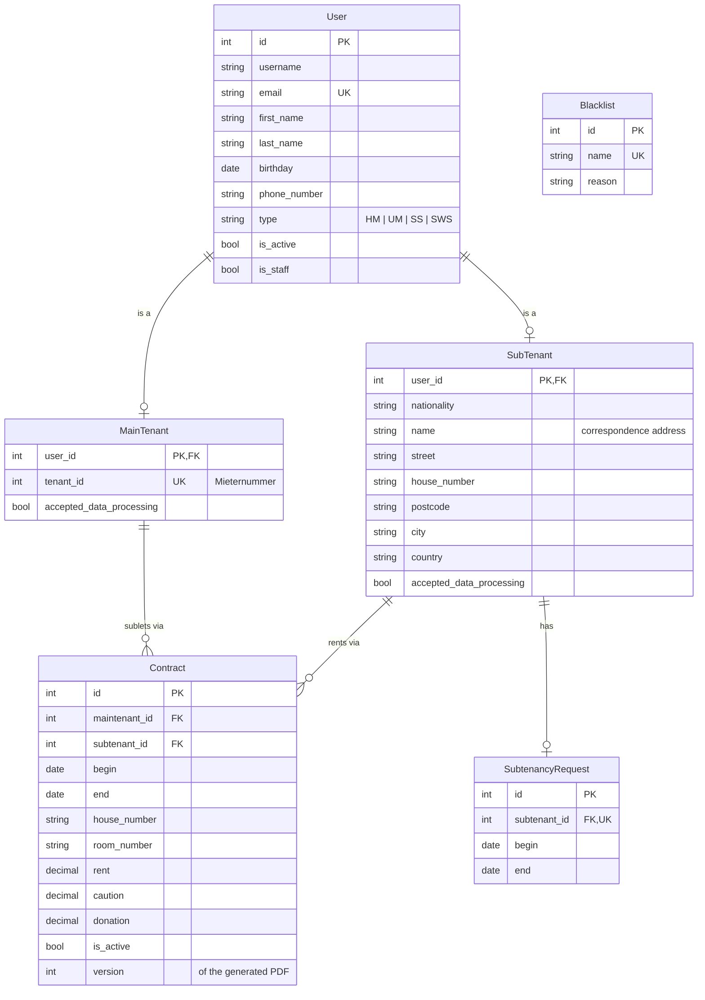

# Straussi3 Subtenancy

Django app for administrating the subtenancy for the Straussi3.

- Link: https://untermiete.straussi3.de
- Link (alternative): https://str3-new.ext.selfnet.de
- Repo: https://github.com/milesstoetzner/straussi3-subtenancy
- Website: https://straussi3.de

## Development

### Setup

Requires Python 3.13 and a local PostgreSQL (see the defaults in the environment table).

```
python -m venv venv
source venv/bin/activate
pip install -r requirements.txt
python manage.py migrate
python develope.py
```

`develope.py` loads `.env.dev` and starts the development server on port 8000.

### Permissions

To set up the permission groups see [permissions](/config/permissions).

### Database

The database is not seeded.
You may import a production database backup.
Therefore, download the backup, extract it, and adjust the following:

1. migrate `djangouser` to `"default"`
2. migrate `postgres` to `"default"`
3. migrate `COPY` to `\copy`
4. remove any `$$PATH$$`

Then import the backup as follows

```
psql -h localhost -U default -d subtenancy -f restore.sql
```

To create the first superuser use a SQL command.
`python manage.py createsuperuser` will not work since the user model is not the original one.
Further users can be created in the admin.

### Schema

`User` is the Django user with a `type` (`HM` maintenant, `UM` subtenant, `SS` assistant, `SWS` Studierendenwerk).
`MainTenant` and `SubTenant` extend it (multi-table inheritance, same primary key).
A subtenant has at most one `SubtenancyRequest`; a `Contract` links one maintenant and one subtenant.



All tables also carry `created_at` and `updated_at`.
Contract PDFs are stored on disk as `contracts/contracts/contract_<id>_version_<n>.pdf`.

## Deployment

### Docker

The app runs as a Docker image built from the [Dockerfile](/Dockerfile) next to a PostgreSQL container, see [docker-compose.yaml](/docker-compose.yaml).
Configuration is read from `/etc/subtenancy/config/backend` and `/etc/subtenancy/config/database`.
Contract PDFs are stored in `/etc/subtenancy/contracts`, the database in `/etc/subtenancy/database`.

```
docker compose up -d --build
```

### Reverse Proxy

The app listens on `127.0.0.1:8000` only.
A reverse proxy in front terminates TLS and must set `X-Forwarded-Proto` and `X-Forwarded-For`.
Set `SUBTENANCY_SECURE_PROXY_SSL_HEADER=HTTP_X_FORWARDED_PROTO,https` and `SUBTENANCY_TRUST_X_FORWARDED_FOR=1` accordingly.

### Migrations

Set `SUBTENANCY_ENABLE_MIGRATIONS=1` to run `python manage.py migrate` on container start.

### Environment

| Environment Variable                    | Default Value        | Description                                                      |
|-----------------------------------------|----------------------|------------------------------------------------------------------|
| `SUBTENANCY_SECRET_KEY`                 |                      | Django secret key (must be set for production).                  |
| `SUBTENANCY_DEBUG`                      | `'0'`                | Enables debug mode if set to `'1'`.                              |
| `SUBTENANCY_ALLOWED_HOSTS`              | `'localhost'`        | Comma-separated list of allowed hosts.                           |
| `SUBTENANCY_ORIGIN`                     | `'http://localhost'` | Used for setting request origin (e.g. for CORS).                 |
| `SUBTENANCY_EMAIL_HOST`                 |                      | Email server hostname or IP address.                             |
| `SUBTENANCY_EMAIL_PORT`                 | `587`                | Email server port.                                               |
| `SUBTENANCY_EMAIL_HOST_USER`            |                      | Email login username.                                            |
| `SUBTENANCY_EMAIL_HOST_PASSWORD`        |                      | Email login password.                                            |
| `SUBTENANCY_EMAIL_USE_TLS`              | `'1'`                | Enable TLS for email connection.                                 |
| `SUBTENANCY_EMAIL_DEFAULT_FROM`         |                      | Default sender email address.                                    |
| `SUBTENANCY_EMAIL_SERVER`               |                      | Server email address used by Django error emails.                |
| `SUBTENANCY_DB_NAME`                    | `'subtenancy'`       | PostgreSQL database name.                                        |
| `SUBTENANCY_DB_USER`                    | `'default'`          | Database username.                                               |
| `SUBTENANCY_DB_PASSWORD`                | `'default'`          | Database password.                                               |
| `SUBTENANCY_DB_HOST`                    | `'127.0.0.1'`        | Database host.                                                   |
| `SUBTENANCY_DB_PORT`                    | `'5432'`             | Database port.                                                   |
| `SUBTENANCY_SECURE_PROXY_SSL_HEADER`    |                      | Header and value tuple for SSL offloading (parsed into a tuple). |
| `SUBTENANCY_SESSION_COOKIE_SECURE`      | `'1'`                | Require HTTPS for session cookie.                                |
| `SUBTENANCY_SESSION_CSRF_COOKIE_SECURE` | `'1'`                | Require HTTPS for CSRF cookie.                                   |
| `SUBTENANCY_ENABLE_MIGRATIONS`          | `'0'`                | Run database migrations.                                         |
| `SUBTENANCY_USE_X_FORWARDED_HOST`       | `'0'`                |                                                                  |
| `SUBTENANCY_TRUST_X_FORWARDED_FOR`      | `'0'`                | Use the first `X-Forwarded-For` address as client IP for the login rate limit. Enable only behind a reverse proxy that sets this header. |

## Operation

### Server

The production system is deployed on a server hosted on Selfnet.

### SSH

You may add the following entry to your `.ssh/config`.

```
Host untermiete
    hostname untermiete.straussi3.de
    identityfile ~/.ssh/id_rsa
    user str3
```

### Release

New releases are deployed manually on the server using `untermiete:~/pull.sh`.

### Backups

A [cronjob](/config/cronjob) backs up the database every night using `untermiete:~/backup.sh`.
Therefore, the database `subtenancy` is dumped and together with all contract pdf files.
To dump the database you need to set up the password in [.pgpass](/config/.pgpass).

### Emails

The production system sends email notifications using the following account.
This email is send-only.
All incoming emails are forwarded to wore.str3@gmail.com for further processing.

- Email: untermiete@straussi3.de
- Inbox: https://mail.ext.selfnet.de/SOGo
- Account: https://mail.ext.selfnet.de/

### Prune Stale Data

Deletes contracts older than three years, tenants without contracts and other non-staff accounts that have not logged in for six months, and the PDF files of the deleted contracts.
Without `--apply` the command is a dry run that only lists what it would delete.

```
python manage.py prune_stale_data          # dry run
python manage.py prune_stale_data --apply  # delete
```
