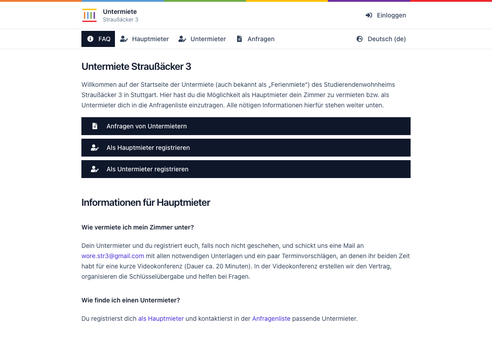
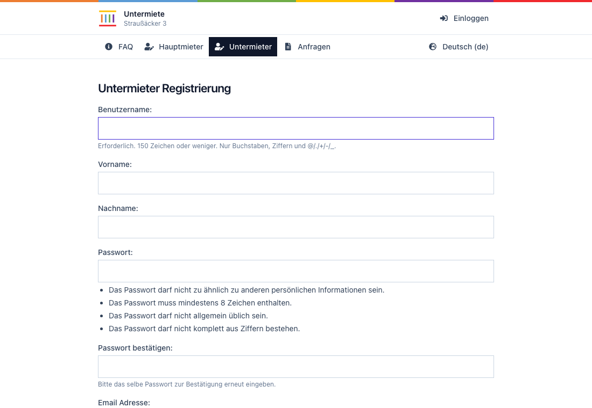
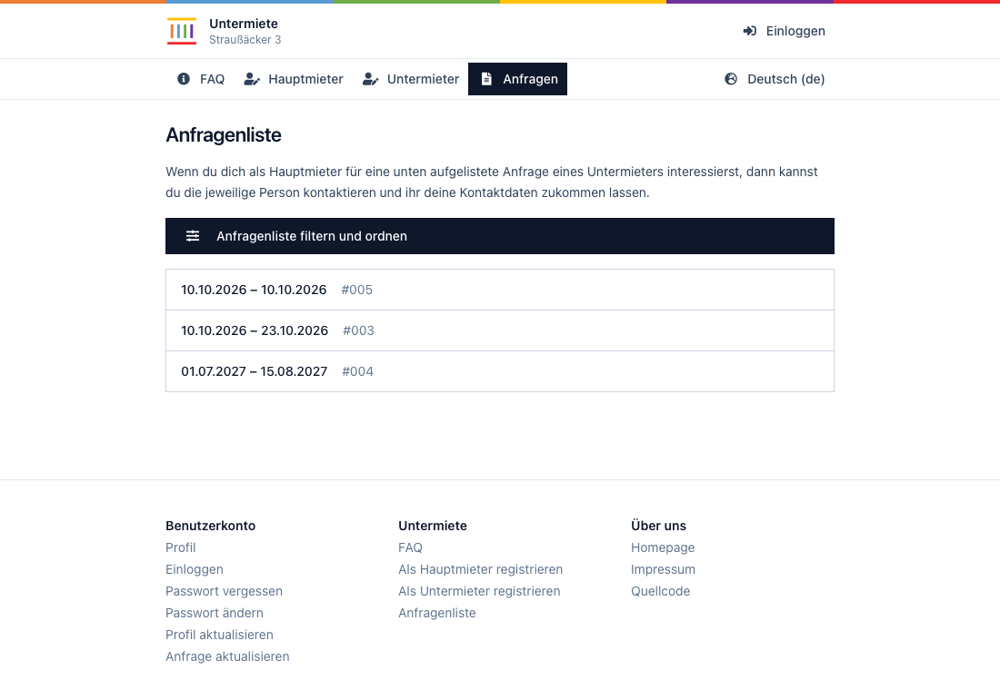
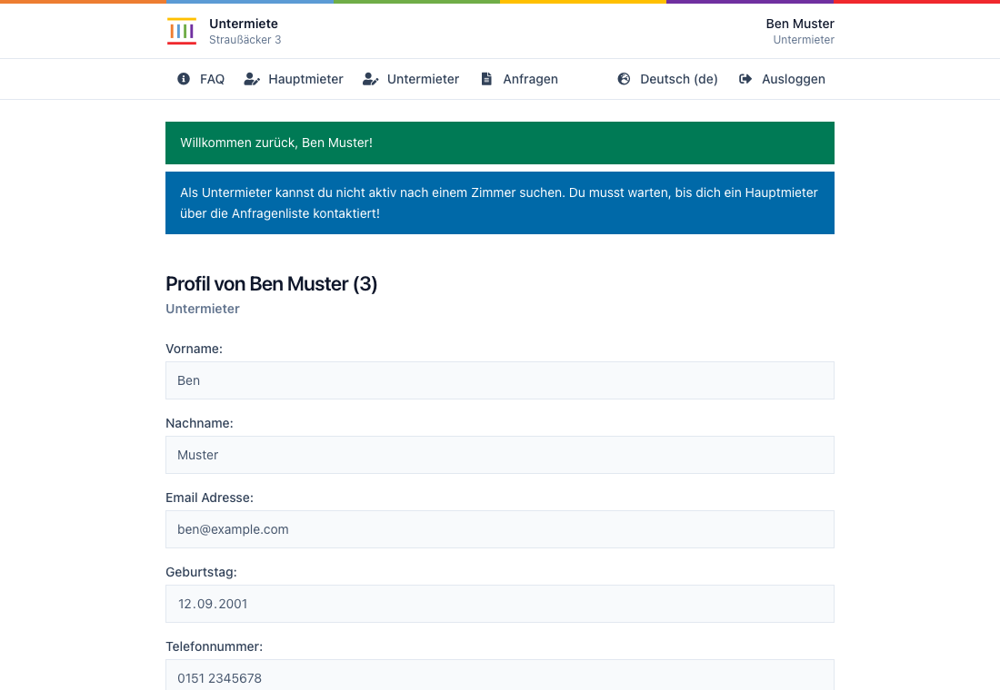
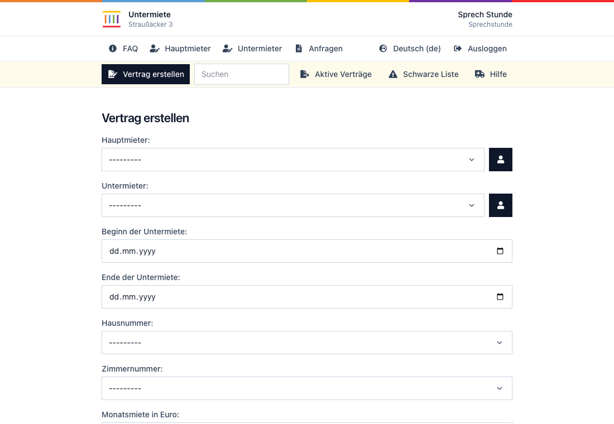
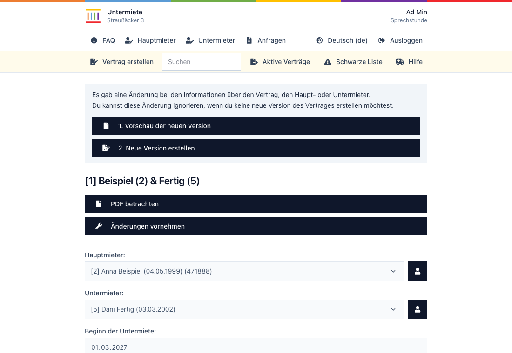
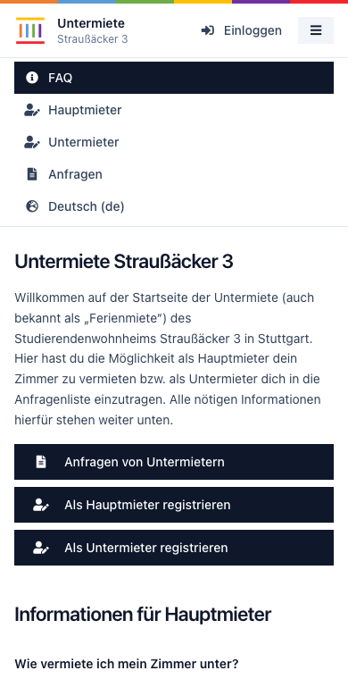
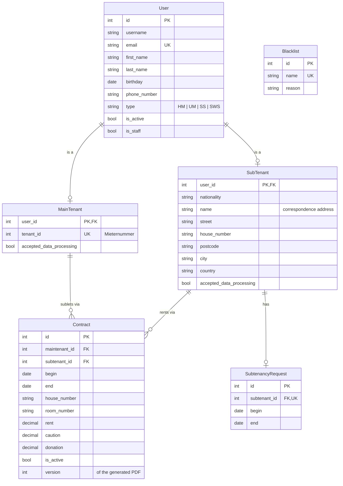

# Straussi3 Subtenancy

Django app for administrating the subtenancy for the Straussi3.

- Link: https://untermiete.straussi3.de
- Link (alternative): https://str3-new.ext.selfnet.de
- Repo: https://github.com/milesstoetzner/straussi3-subtenancy
- Website: https://straussi3.de

## Contents

- [Screenshots](#screenshots)
- [Development](#development)
  - [Setup](#setup)
  - [Tests](#tests)
  - [CSS](#css)
  - [Permissions](#permissions)
  - [Database](#database)
  - [Schema](#schema)
- [Deployment](#deployment)
  - [Docker](#docker)
  - [Reverse Proxy](#reverse-proxy)
  - [Migrations](#migrations)
  - [Environment](#environment)
- [Operations](#operations)
  - [Server](#server)
  - [SSH](#ssh)
  - [Installation](#installation)
  - [Release](#release)
  - [Migration](#migration)
  - [Backups](#backups)
  - [Restore](#restore)
  - [Emails](#emails)
  - [Sprechstunde Accounts](#sprechstunde-accounts)
  - [Data Access Requests](#data-access-requests)
  - [Prune Stale Data](#prune-stale-data)

## Screenshots

| | |
|---|---|
|  |  |
|  |  |
|  |  |



## Development

### Setup

Requires Python 3.13 and a local PostgreSQL (see the defaults in the environment table).

```
python -m venv venv
source venv/bin/activate
pip install -r requirements.txt
python manage.py init_database --superuser admin --email admin@example.org
python develope.py
```

`init_database` runs the migrations, creates the permission groups and a superuser for the admin (prints the password).
`develope.py` loads `.env.dev` and starts the development server on port 8000.

### Tests

End-to-end tests drive a real browser (Playwright) against Django's live test server and need a PostgreSQL.

```
pip install -r requirements-dev.txt
playwright install chromium
SUBTENANCY_DB_PORT=5433 pytest
```

They run in GitHub Actions on every pull request, see [e2e.yml](/.github/workflows/e2e.yml).

### CSS

The stylesheet is built with Tailwind from `tenants/static_src/app.css` into `tenants/static/subtenancy/app.css`, which is committed.
Running, deploying and testing the app never needs the build; Docker just collects the committed file.
Rebuild only after changing the source or using a Tailwind class in a template that was not used before, then commit the result
(downloads the Tailwind standalone CLI on first use, no Node needed):

```
config/build-css.sh          # once
config/build-css.sh --watch  # while editing
```

### Permissions

Access is checked per view with Django permissions; accounts get them through four groups.
Registration puts every new account into `Maintenant` or `Subtenant`, `create_assistant` into `Assistant`;
`External` is meant for the Studierendenwerk, which only prints the list of active contracts.

| Group        | Permissions                                                                                      |
|--------------|--------------------------------------------------------------------------------------------------|
| `Maintenant` | edit own profile, contact subtenants                                                             |
| `Subtenant`  | edit own profile                                                                                 |
| `Assistant`  | view and edit users, maintenants and subtenants; view the blacklist; add, view and edit contracts; print the active contracts |
| `External`   | print the active contracts                                                                       |

The groups are defined in [tenants/groups.py](/tenants/groups.py) and created by `python manage.py sync_groups`,
which also resets their permissions to that definition (changes made in the admin do not survive it).
The command is idempotent; `init_database`, the container entrypoint and [config/deploy.sh](/config/deploy.sh) run it after `migrate`.

### Database

The database is not seeded.
You may import a production database backup.
Therefore, download the backup, extract it, and adjust the following:

1. migrate `djangouser` to `"default"`
2. migrate `postgres` to `"default"`
3. migrate `COPY` to `\copy`
4. remove any `$$PATH$$`

Then import the backup as follows

```
psql -h localhost -U default -d subtenancy -f restore.sql
```

To create the first superuser use a SQL command.
`python manage.py createsuperuser` will not work since the user model is not the original one.
Further users can be created in the admin.

### Schema

`User` is the Django user with a `type` (`HM` maintenant, `UM` subtenant, `SS` assistant, `SWS` Studierendenwerk).
`MainTenant` and `SubTenant` extend it (multi-table inheritance, same primary key).
A subtenant has at most one `SubtenancyRequest`; a `Contract` links one maintenant and one subtenant.



All tables also carry `created_at` and `updated_at`.
Contract PDFs are stored on disk as `contracts/contracts/contract_<id>_version_<n>.pdf`.

## Deployment

### Docker

The app runs as a Docker image built from the [Dockerfile](/Dockerfile) next to a PostgreSQL container, see [docker-compose.yaml](/docker-compose.yaml).
Configuration is read from `/etc/subtenancy/config/backend` and `/etc/subtenancy/config/database`.
Contract PDFs are stored in `/etc/subtenancy/contracts`, the database in `/etc/subtenancy/database`.

```
docker compose up -d --build
```

### Reverse Proxy

The app listens on `127.0.0.1:8000` only.
A reverse proxy in front terminates TLS and must set `X-Forwarded-Proto` and `X-Forwarded-For`.
Set `SUBTENANCY_SECURE_PROXY_SSL_HEADER=HTTP_X_FORWARDED_PROTO,https` and `SUBTENANCY_TRUST_X_FORWARDED_FOR=1` accordingly.

### Migrations

Set `SUBTENANCY_ENABLE_MIGRATIONS=1` to run `python manage.py migrate` and `sync_groups` on container start.

### Environment

| Environment Variable                    | Default Value        | Description                                                      |
|-----------------------------------------|----------------------|------------------------------------------------------------------|
| `SUBTENANCY_SECRET_KEY`                 |                      | Django secret key (must be set for production).                  |
| `SUBTENANCY_DEBUG`                      | `'0'`                | Enables debug mode if set to `'1'`.                              |
| `SUBTENANCY_ALLOWED_HOSTS`              | `'localhost'`        | Comma-separated list of allowed hosts.                           |
| `SUBTENANCY_ORIGIN`                     | `'http://localhost'` | Used for setting request origin (e.g. for CORS).                 |
| `SUBTENANCY_EMAIL_HOST`                 |                      | Email server hostname or IP address.                             |
| `SUBTENANCY_EMAIL_PORT`                 | `587`                | Email server port.                                               |
| `SUBTENANCY_EMAIL_HOST_USER`            |                      | Email login username.                                            |
| `SUBTENANCY_EMAIL_HOST_PASSWORD`        |                      | Email login password.                                            |
| `SUBTENANCY_EMAIL_USE_TLS`              | `'1'`                | Enable TLS for email connection.                                 |
| `SUBTENANCY_EMAIL_DEFAULT_FROM`         |                      | Default sender email address.                                    |
| `SUBTENANCY_EMAIL_SERVER`               |                      | Server email address used by Django error emails.                |
| `SUBTENANCY_DB_NAME`                    | `'subtenancy'`       | PostgreSQL database name.                                        |
| `SUBTENANCY_DB_USER`                    | `'default'`          | Database username.                                               |
| `SUBTENANCY_DB_PASSWORD`                | `'default'`          | Database password.                                               |
| `SUBTENANCY_DB_HOST`                    | `'127.0.0.1'`        | Database host.                                                   |
| `SUBTENANCY_DB_PORT`                    | `'5432'`             | Database port.                                                   |
| `SUBTENANCY_SECURE_PROXY_SSL_HEADER`    |                      | Header and value tuple for SSL offloading (parsed into a tuple). |
| `SUBTENANCY_SESSION_COOKIE_SECURE`      | `'1'`                | Require HTTPS for session cookie.                                |
| `SUBTENANCY_SESSION_CSRF_COOKIE_SECURE` | `'1'`                | Require HTTPS for CSRF cookie.                                   |
| `SUBTENANCY_ENABLE_MIGRATIONS`          | `'0'`                | Run database migrations.                                         |
| `SUBTENANCY_USE_X_FORWARDED_HOST`       | `'0'`                |                                                                  |
| `SUBTENANCY_TRUST_X_FORWARDED_FOR`      | `'0'`                | Use the first `X-Forwarded-For` address as client IP for the login rate limit. Enable only behind a reverse proxy that sets this header. |

## Operations

### Server

The production system is deployed on a server hosted on Selfnet.

### SSH

You may add the following entry to your `.ssh/config`.

```
Host untermiete
    hostname untermiete.straussi3.de
    identityfile ~/.ssh/id_rsa
    user str3
```

### Installation

A new server needs Docker, the repository and the data directories; everything else is created by the app.

1. Clone the repository to `/home/str3/straussi3-subtenancy`.
2. Create `/etc/subtenancy/config`, `/etc/subtenancy/contracts` and `/etc/subtenancy/database`.
3. Write `/etc/subtenancy/config/backend` with the variables from [Environment](#environment) and
   `/etc/subtenancy/config/database` with `POSTGRES_USER`, `POSTGRES_PASSWORD` and `POSTGRES_DB` matching
   `SUBTENANCY_DB_USER`, `SUBTENANCY_DB_PASSWORD` and `SUBTENANCY_DB_NAME`.
4. Start the stack and initialise the database: migrations, permission groups and the first superuser for the admin
   (the command prints its password). To continue from a backup instead, see [Restore](#restore).

   ```
   docker compose up -d --build
   docker compose exec backend python manage.py init_database --superuser USERNAME --email EMAIL
   ```

5. Install the [cronjob](/config/cronjob) and the [reverse proxy](#reverse-proxy).

`init_database` can be run again at any time; it keeps existing data and creates the superuser only if there is none.

### Release

New releases are deployed manually on the server using `untermiete:~/pull.sh`.

### Backups

A [cronjob](/config/cronjob) runs [config/backup.sh](/config/backup.sh) every night.
It dumps the database through the database container and packs it together with all contract PDFs into
`subtenancy_backup_<timestamp>.tar.gz` in `/home/str3/backups`; archives older than 30 days are deleted.

```
config/backup.sh [BACKUP_DIR]
```

### Restore

[config/restore.sh](/config/restore.sh) restores such an archive into an **empty** installation: it refuses if the
database already contains tables or the contracts directory is not empty.
To restore over an existing installation, stop it and clear the data first.

```
docker compose down
sudo rm -rf /etc/subtenancy/database/* /etc/subtenancy/contracts/*
config/restore.sh /home/str3/backups/subtenancy_backup_<timestamp>.tar.gz
```

The script starts the database, restores the dump and the PDFs, then starts the whole stack.
Both scripts read `CONTRACTS_DIR` (default `/etc/subtenancy/contracts`) and `BACKUP_DIR` (default `/home/str3/backups`) from the environment.

### Emails

The production system sends email notifications using the following account.
This email is send-only.
All incoming emails are forwarded to wore.str3@gmail.com for further processing.

- Email: untermiete@straussi3.de
- Inbox: https://mail.ext.selfnet.de/SOGo
- Account: https://mail.ext.selfnet.de/

### Sprechstunde Accounts

Accounts for the Sprechstunde (assistants) are created on the server; the command prints a random start password.
The group `Assistant` is created by `sync_groups`, see [Permissions](#permissions).

```
docker compose exec backend python manage.py create_assistant USERNAME EMAIL --first-name VORNAME --last-name NACHNAME
```

### Data Access Requests

Under Art. 15 GDPR a person may ask which personal data we store about them.
The command collects everything the application holds about one user (account, tenant details, request, contracts
including the PDF file names) as JSON; identify the person by username, e-mail address or id.

```
docker compose exec backend python manage.py export_personal_data USERNAME_OR_EMAIL                     # JSON to stdout
docker compose exec backend python manage.py export_personal_data USERNAME_OR_EMAIL --pdf /tmp/auskunft.pdf
```

The PDF is styled like the contract documents; `--output FILE` writes the JSON to a file instead.

Server logs and sent e-mails live with the hosting and mail provider and are not part of the export.

### Prune Stale Data

Deletes contracts older than three years, tenants without contracts and other non-staff accounts that have not logged in for six months, and the PDF files of the deleted contracts.
Without `--apply` the command is a dry run that only lists what it would delete.

```
python manage.py prune_stale_data          # dry run
python manage.py prune_stale_data --apply  # delete
```

On the server the [cronjob](/config/cronjob) runs [config/prune-stale-data.sh](/config/prune-stale-data.sh) `--apply` every night at 03:20, an hour after the backup.
